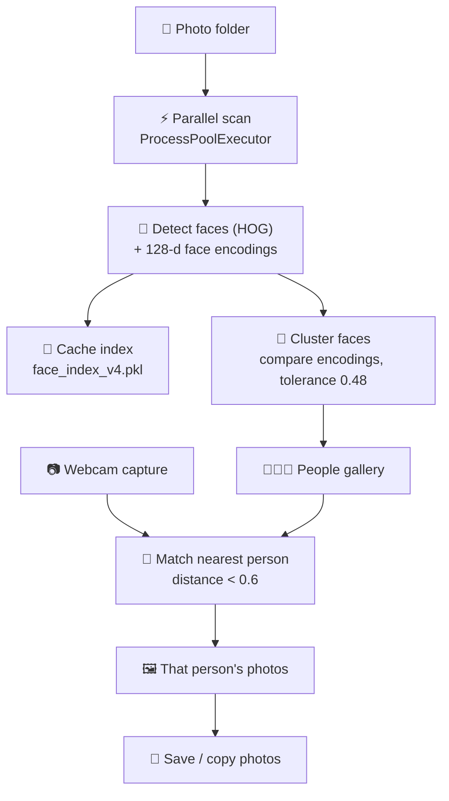

<div align="center">

# 📸 Gallery Perfect — AI Photobooth Face Finder

**A desktop app that scans a folder of event photos, groups them by person using face recognition, and lets anyone find all of their photos just by showing their face to the camera.**


[Overview](#-overview) • [Features](#-features) • [How It Works](#-how-it-works) • [Tech Stack](#-tech-stack) • [Getting Started](#-getting-started) • [Usage](#-how-to-use) • [Tuning](#-tuning)

</div>

---

## 📋 Overview

At an event, hundreds of photos are taken and nobody wants to scroll through all of them to find their own. **Gallery Perfect** fixes that.

Point it at a folder of photos and it automatically finds every face and groups the photos by person. Then a guest simply clicks **Scan My Face**, looks at the camera, and the app jumps straight to the photos they appear in. Their photos can be copied to a folder in one click.

---

## ✨ Features

- 📂 **Open a photo folder** and scan every image for faces
- 🧑‍🤝‍🧑 **Automatic people grouping** — each unique person gets a card with a cropped face thumbnail and a photo count, sorted by who appears most
- 📷 **Find me by face** — capture your face with a laptop webcam **or a phone camera** (IP Webcam) and the app opens your photos
- 🖼️ **Photo gallery** for each person with thumbnails loaded in the background
- 🔍 **Full-screen viewer** — navigate with the **← / →** keys, **Esc** to close, with the next photo pre-loaded for instant switching
- 💾 **Save This Person** — copies all of that person's photos to a folder you choose
- ⚡ **Fast** — scans in parallel across all CPU cores, and shrinks very large photos before detection
- 🧠 **Scan cache** — results are saved in the photo folder (`face_index_v4.pkl`), so reopening the same folder can load instantly
- 🌑 Dark-mode interface with a progress bar and live status

---

## ⚙️ How It Works



1. **Scan.** Each photo is loaded (images wider than 1200 px are scaled down for speed), faces are located with dlib's HOG detector, and a 128-number *encoding* is computed for each face.
2. **Group.** Every encoding is compared with the people found so far. If it matches one (strict tolerance **0.48**), the photo is added to that person; otherwise a new person is created. A photo is never added twice to the same person.
3. **Find me.** The camera frame is turned into an encoding and compared with every person. The closest one under distance **0.6** is opened.

---

## 🛠️ Tech Stack

| Purpose | Library |
|---|---|
| **GUI** | CustomTkinter (dark theme) |
| **Face detection & recognition** | `face_recognition` (built on dlib) |
| **Image & camera handling** | OpenCV, Pillow |
| **Numerics** | NumPy |
| **Parallelism** | `concurrent.futures.ProcessPoolExecutor`, `threading` |
| **Caching** | `pickle` |

---

## 🚀 Getting Started

### Prerequisites

- **Windows**, with **Python 3.11**
- A webcam, or a phone with the *IP Webcam* app (optional)
- Installing `dlib` needs a C++ compiler (Visual Studio Build Tools + CMake). Prebuilt wheels for Python 3.11 also work.

### Install

```bash
git clone https://github.com/IshanPatel1912/Photobooth.git
cd Photobooth

python -m venv venv
venv\Scripts\activate

pip install customtkinter opencv-python pillow numpy dlib face_recognition
```

### Run

```bash
python main.py
```

---

## 📖 How to Use

1. Click **1. Open Folder** and choose the folder with your photos. If it was scanned before, the app offers to **load the previous scan instantly**.
2. Wait for the scan to finish. The **People Found** tab shows every person detected.
3. Either click a person to see their photos, or find yourself:
   - choose **Laptop Webcam**, or **IP Webcam (Phone)** and type your phone's stream address (for example `http://192.168.X.X:8080/video`),
   - click **2. Scan My Face**, then **CAPTURE**.
4. Click any thumbnail to open the full-screen viewer (**←** / **→** / **Esc**).
5. Click **Save This Person** to copy all of their photos to another folder.

---

## 🎛️ Tuning

| Setting | Where | Effect |
|---|---|---|
| `TOLERANCE = 0.48` | `cluster_faces()` | Lower = stricter grouping (fewer wrong merges), higher = looser |
| `dist < 0.6` | `find_person_by_face()` | How close a webcam face must be to a person to count as a match |
| `1200` px | `process_image_file()` | Photos wider than this are scaled down before face detection |
| `model="hog"` | `process_image_file()` | Fast CPU detector. `"cnn"` is more accurate but needs a GPU |

---

## ⚠️ Notes

- Faces are processed **entirely on your computer**. No photos are uploaded anywhere.
- Accuracy depends on lighting, angle and photo quality. Very small or turned-away faces can be missed.
- The first scan of a large folder takes the longest; later runs use the cache.

---

## 🗺️ Roadmap

- [ ] Print / QR-code sharing of a guest's photos
- [ ] Name people and merge duplicate groups manually
- [ ] Support for a GPU (`cnn`) detector option
- [ ] Packaged `.exe` for event-day use

---

## 👤 Author

**Ishan Patel** — Undergraduate student, Pandit Deendayal Energy University (PDEU)

[](https://github.com/IshanPatel1912)

---

<div align="center">

**Built with ❤️ and Python**

[🔝 Back to top](#-gallery-perfect--ai-photobooth-face-finder)

</div>
